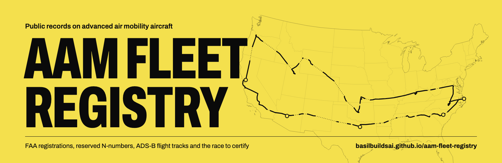
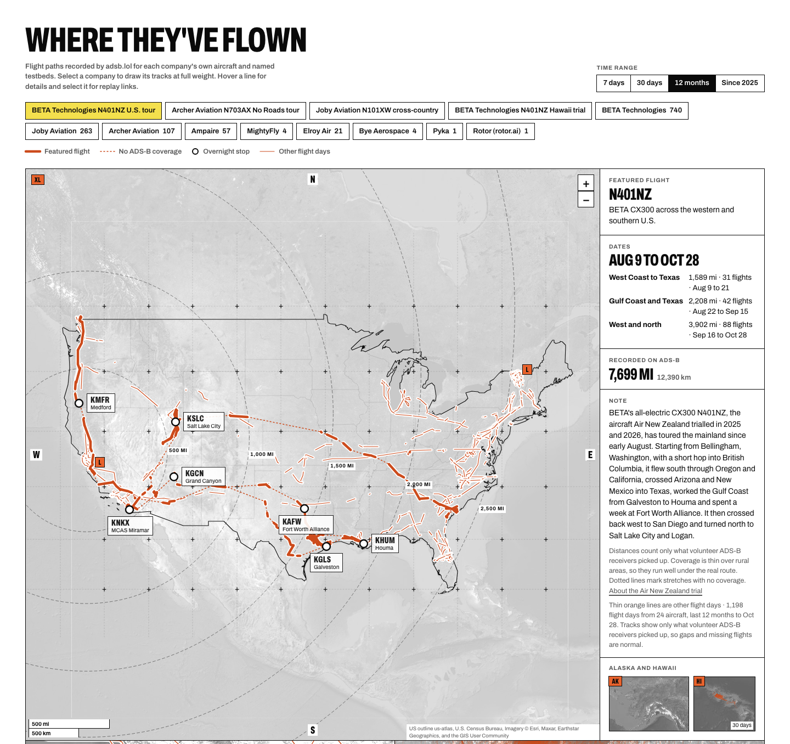
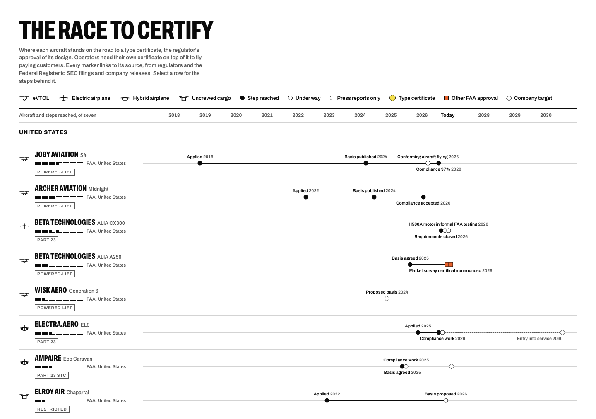
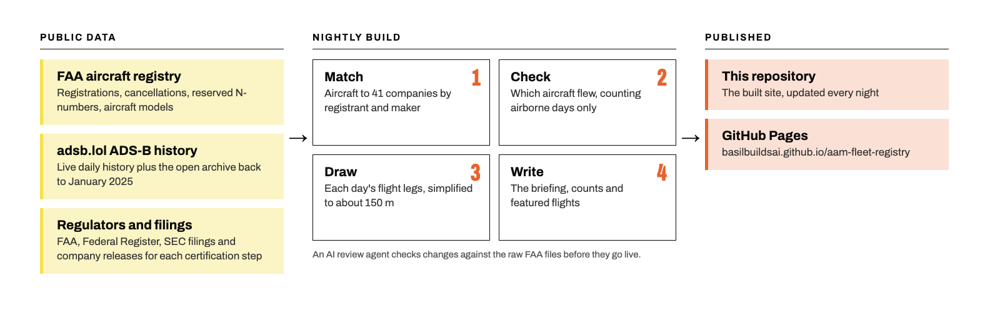

A live tracker of the aircraft that advanced air mobility (AAM) companies hold on the FAA registry, the N-numbers they have reserved, where those aircraft have flown, and how far each one has come toward a type certificate.

**[Open the live site →](https://basilbuildsai.github.io/aam-fleet-registry/)**

Air taxis, electric airplanes and hybrid electric aircraft are flying every day in test programs across the country. The public record of that work is scattered. Registrations sit in the FAA's aircraft database, flights show up only on volunteer ADS-B networks, and certification steps are spread across regulator notices, the Federal Register, SEC filings and company releases. This site pulls them together for 41 companies, with a link back to every source.

This repository holds the published website. It is rebuilt every night from public FAA and ADS-B data. The source code is private for now.

## What it shows

- **Registered aircraft.** Every aircraft that 41 eVTOL, eSTOL and hybrid electric companies hold on the U.S. civil aircraft registry, including Joby, BETA, Archer, Wisk, Elroy Air, Electra, Rotor and others. Each N-number links to its FAA record. Aircraft each company designed itself (183 today) are counted separately from the chase planes, trainers and test conversions it owns.
- **Reserved N-numbers.** Registrations held for aircraft that have not been registered yet, nearly 1,700 of them.
- **Who is flying.** Which aircraft were seen airborne on public ADS-B in the last 45 days, with replay links to adsb.lol and ADS-B Exchange.
- **Where they fly.** A flight map drawn like a site plan, with Alaska and Hawaii insets and close-ups of the busiest test areas, Monterey Bay and Salinas for Joby and Archer, and Lake Champlain for BETA. A second set of maps covers the same aircraft flying abroad, so far in Europe, New Zealand, Japan and the United Arab Emirates.
- **Featured flights.** Notable trips stay on the map permanently, each with its dates, distance and a short account. These include Joby's autonomous Cessna Caravan (N101XW) flying coast to coast and back, BETA's all-electric CX300 (N401NZ) in Hawaii with Surf Air and then touring the western and southern U.S., and Archer's Midnight (N703AX) on its "No Roads" tour of the Bay Area.
- **Spotlight on Joby, BETA and Archer.** One tab per company, with its fleet, flying, FAA models, reservations and support aircraft.
- **Latest from the registry and the radar.** A short briefing written by each night's build, covering new registration certificates, reservations and the week's flying.
- **A manufacturer directory** covering U.S. and international programs, including those with no U.S. registrations.

- **The race to certify.** Where 22 aircraft in the U.S., China, Brazil, Japan, the UK and Europe stand on the road to a type certificate, step by step from application to production and service. U.S. rows show their FAA path, whether Part 23, powered-lift, a supplemental type certificate or restricted category. Every marker links to its source, and steps known only from press reports are marked as such. Other FAA approvals, such as BETA's market survey certificate for the A250, appear on the same timeline.

## How it works

1. Each night the build downloads the FAA Releasable Aircraft Database, with its current registrations, cancellations, reservations and aircraft models.
2. It matches aircraft to companies by registrant and by the maker listed in the FAA model table. Unrelated companies that share a name were removed by hand.
3. It checks adsb.lol's public daily history for every registered aircraft. A day counts as seen only when the aircraft reported airborne positions. Flights older than the live history, back to January 2025, come from adsb.lol's open daily archive.
4. It draws each day's airborne legs on the map, simplified to about 150 m (500 ft), and writes the briefing, counts and featured flights.
5. GitHub Actions publishes the result here, and GitHub Pages serves it.

Certification steps are curated by hand from regulator notices, the Federal Register, SEC filings and company releases. An independent AI review agent checks each change against the raw FAA files before it goes live.

## About ADS-B coverage and privacy

Aircraft appear on the map only while their transponder is on and a volunteer receiver is in range. Coverage is thin over rural areas, so recorded distances run under the real route. Takeoffs and landings can be missed where no receiver is close by, and test aircraft that fly with ADS-B off or under a privacy address will not show up.

Some owners ask the FAA to limit tracking of their aircraft through the LADD program. LADD asks commercial services such as FlightAware and Flightradar24 to hide those aircraft. It does not change what an aircraft broadcasts, so aircraft flying on their registered ADS-B code still appear in volunteer networks like adsb.lol, which is where this site's flight data comes from.

## Files

| Path | What it is |
|---|---|
| `index.html` | The whole page: layout, styles, map code and the night's data, built into one file |
| `og.png` | The preview image shown when the site is shared |
| `readme/` | The images in this README, taken from the live site or drawn in its style |

To view it locally, serve the folder with any static web server, for example `python3 -m http.server`, and open `http://localhost:8000`.

## Data and credits

| Source | Used for |
|---|---|
| [FAA Releasable Aircraft Database](https://www.faa.gov/licenses_certificates/aircraft_certification/aircraft_registry/releasable_aircraft_download) | Registrations, cancellations, reservations and aircraft models |
| [adsb.lol](https://adsb.lol) | Public ADS-B flight history |
| FAA, Federal Register, SEC EDGAR and other regulators | Certification steps, linked from each marker on the page |
| [Esri World Imagery](https://www.arcgis.com/home/item.html?id=10df2279f9684e4a9f6a7f08febac2a9) | Map imagery (Esri, Maxar, Earthstar Geographics) |
| [us-atlas](https://github.com/topojson/us-atlas) | U.S. outline, based on U.S. Census Bureau data |
| [OurAirports](https://ourairports.com/data/) | Airport names and positions for featured flight stops |
| [Leaflet](https://leafletjs.com) | Interactive maps |

Company status notes reflect public reporting and are reviewed by hand.

## Help improve it

Spotted a wrong registration, a missing aircraft or a certification step without a source? [Open an issue](https://github.com/basilbuildsai/aam-fleet-registry/issues) with the N-number or aircraft and a link, or message me on [LinkedIn](https://www.linkedin.com/in/basil-yap-461b1975/).

## Built by

Basil Yap. Accelerating autonomy and AI in aviation. Building open-source projects. Others include the [U.S. AAM Resource Map](https://basilbuildsai.github.io/aam-resource-map/) and the [DFR Adoption Map](https://basilbuildsai.github.io/dfr-program-map/).
